<!-- GitHub-rendered copy of docs/high-level-visual-memory-report/index.html. -->

<header><h1>Incremental Subtask Planning: High-Level and Low-Level Interaction Report</h1>
Two robot-manipulation tasks under three visual-history settings
</header>

<main>
<section><h2>Experimental Logic</h2>

The robot control system has two layers. A high-level vision-language model decomposes a natural-language task into executable object-level subtasks and judges whether the current subtask is complete. A low-level action model receives the current subtask text and directly generates continuous actions for the dual-arm robot.

This experiment uses incremental subtask planning. At task start, the high-level model generates only the first subtask, which is sent to the low-level action model. While that subtask executes, the system prepares a possible next subtask in the background but does not publish it immediately. At a preset inspection time, low-level execution pauses; the high-level model views current or historical camera images and answers only whether the current subtask is complete.

Only when the high-level model answers “completed” does the system send the prepared next subtask to the low-level action model and discard cached actions tied to the old instruction. When it answers “not completed,” the low-level model continues the current subtask and retains its action cache. This separates visual completion detection from semantic generation of the next subtask.

The experiment covers “Place burger and fries” and “Put bottles in dustbin.” Visual inputs are: the current image at the inspection time; history sampled every 2 seconds; and history sampled at 1 frame per second. Each condition has 3 valid samples. The low-level model pauses while the high-level model works, so the total interaction time includes the real wait caused by high-level completion detection.

</section>
<section><h2>Concrete Example</h2>

For “Place burger and fries,” the high-level planner first generates “place the burger on the tray” and prepares “place the fries on the tray” while the low-level model executes. The robot pauses at 2.40 seconds and the completion verifier sees frames 0, 25, 50, and 60. If it returns <code>{"completed":true}</code>, the system sends “place the fries on the tray” to the low-level action model, clears cached actions left from the burger subtask, and records the time until the low-level model produces its first action under the new instruction. If it returns <code>{"completed":false}</code>, the fries subtask is not published and the robot continues “place the burger on the tray.”
</section>
<h2>Interaction Time and Output Format in This Run</h2><table><thead><tr><th>Task</th><th>Visual input</th><th>Valid samples</th><th>Control action after completion check</th><th>Mean input images</th><th>Mean input tokens</th><th>Mean output tokens</th><th>Required-format adherence</th><th>Check triggered → decision ready</th><th>Check triggered → first low-level action</th></tr></thead><tbody><tr><td>Place burger and fries</td><td>History sampled at 1 frame per second</td><td>3</td><td>Continue current subtask: 1; publish next subtask: 2</td><td>4.0</td><td>1219.0</td><td>6.0</td><td>75.0%</td><td>457.6 ms</td><td>1083.7 ms</td></tr><tr><td>Put bottles in dustbin</td><td>History sampled at 1 frame per second</td><td>3</td><td>Continue current subtask: 3; publish next subtask: 0</td><td>6.0</td><td>1777.0</td><td>6.0</td><td>100.0%</td><td>477.6 ms</td><td>484.2 ms</td></tr><tr><td>Place burger and fries</td><td>History sampled every 2 seconds</td><td>3</td><td>Continue current subtask: 2; publish next subtask: 1</td><td>3.0</td><td>950.7</td><td>6.0</td><td>100.0%</td><td>343.4 ms</td><td>644.3 ms</td></tr><tr><td>Put bottles in dustbin</td><td>History sampled every 2 seconds</td><td>3</td><td>Continue current subtask: 3; publish next subtask: 0</td><td>4.0</td><td>1230.3</td><td>6.0</td><td>100.0%</td><td>373.4 ms</td><td>379.6 ms</td></tr><tr><td>Place burger and fries</td><td>Current image only</td><td>3</td><td>Continue current subtask: 2; publish next subtask: 1</td><td>1.0</td><td>392.3</td><td>6.0</td><td>100.0%</td><td>243.0 ms</td><td>544.5 ms</td></tr><tr><td>Put bottles in dustbin</td><td>Current image only</td><td>3</td><td>Continue current subtask: 3; publish next subtask: 0</td><td>1.0</td><td>399.3</td><td>6.0</td><td>100.0%</td><td>216.6 ms</td><td>222.1 ms</td></tr></tbody></table>
<section><h2>How to Interpret the Timing</h2>
“Check triggered → decision ready” fully records the wait caused by a high-level vision-language completion check and can be compared directly across visual-input settings. In contrast, “Check triggered → first low-level action” is also affected by the action cache. When the model judges that the current subtask is not complete, the system retains the existing instruction and generated action cache; the low-level model may directly take a cached action rather than run another neural-network inference. This value is therefore not always the full low-level inference time required after switching to a new subtask and should not be compared directly with samples that do switch subtasks.

Thus, a low-level action time near 0 ms does not mean the robot stopped being controlled. It means that step reused a previously generated action; the high-level completion-check time itself is still fully measured.
</section>
<section><h2>Why Current Single-Image Times Are Lower Than the Earlier ~400 ms Result</h2>
The earlier ~400 ms value came from a text-only prompt-latency benchmark using the former multi-field JSON output. The model generated about 17 tokens on average, including a control decision, execution status, and a textual reason. This page uses the new, real robot completion request: although the input includes one camera image and about 400 input tokens, the model is required to output only <code>{"completed":true}</code> or <code>{"completed":false}</code>, averaging 6 output tokens.

For this model, generation is a material part of the latency of short requests. Shortening the output protocol therefore reduces current single-image completion checks to about 0.22–0.29 seconds. This change primarily reflects the shorter output format; it should not be interpreted as visual understanding itself becoming faster. The old text-only benchmark and the real image-based completion check on this page are not identical metrics.
</section>
<h2>Actual Prompts Received by the Models and Raw Outputs</h2>

Place burger and fries / History sampled at 1 frame per second

The following is the exact English input sent to the models and their raw output, retained for reproducibility.
<h4>Completion verifier: full input</h4><pre>Verify whether the current robot subtask is completed.
Task: Pick up the rounded rectangular hamburg wrap and the Golden fries in red carton box together, then drop on the medium flat tray
Current subtask: Pick up the rounded rectangular hamburg wrap and the Golden fries in red carton box and place them on the medium flat tray
Images: 4 accumulated head-camera frames not previously sent to high-level: [0, 25, 50, 60]
Use completed=true only when the subtask's final goal state is clearly visible. Otherwise use completed=false.
Return exactly one JSON object and no Markdown:
{"completed": true | false}</pre><h4>Completion verifier: raw output</h4><pre>evidence_frame_ids=[0, 25, 50, 60]
{"completed": false}</pre><h4>Next-subtask planner: full input</h4><pre>Generate the next object-level robot subtask.
Task: Pick up the rounded rectangular hamburg wrap and the Golden fries in red carton box together, then drop on the medium flat tray
Current subtask: Pick up the rounded rectangular hamburg wrap and the Golden fries in red carton box and place them on the medium flat tray
Next subtask index: 2
The new subtask must name the object and its final target.
Do not repeat the current subtask. Do not verify completion.
Do not output a grasp-only, lift-only, move-only, or release-only step.
Return exactly one JSON object and no Markdown:
{"next_subtask": string}</pre><h4>Next-subtask planner: raw output</h4><pre>evidence_frame_ids=[]; text_only=true
{"next_subtask": "Pick up the rounded rectangular hamburg wrap and place it on the medium flat tray"}</pre>

Put bottles in dustbin / History sampled at 1 frame per second

The following is the exact English input sent to the models and their raw output, retained for reproducibility.
<h4>Completion verifier: full input</h4><pre>Verify whether the current robot subtask is completed.
Task: Move the plastic bottle with two distinct parts, the bottle with blue highlights, and the plastic bottle with ridges near bottom into the curved rectangular trash can on the left of the table.
Current subtask: Move the plastic bottle with two distinct parts into the curved rectangular trash can on the left of the table.
Images: 6 accumulated head-camera frames not previously sent to high-level: [0, 25, 50, 75, 100, 101]
Use completed=true only when the subtask's final goal state is clearly visible. Otherwise use completed=false.
Return exactly one JSON object and no Markdown:
{"completed": true | false}</pre><h4>Completion verifier: raw output</h4><pre>evidence_frame_ids=[0, 25, 50, 75, 100, 101]
{"completed": false}</pre><h4>Next-subtask planner: full input</h4><pre>Generate the next object-level robot subtask.
Task: Move the plastic bottle with two distinct parts, the bottle with blue highlights, and the plastic bottle with ridges near bottom into the curved rectangular trash can on the left of the table.
Current subtask: Move the plastic bottle with two distinct parts into the curved rectangular trash can on the left of the table.
Next subtask index: 2
The new subtask must name the object and its final target.
Do not repeat the current subtask. Do not verify completion.
Do not output a grasp-only, lift-only, move-only, or release-only step.
Return exactly one JSON object and no Markdown:
{"next_subtask": string}</pre><h4>Next-subtask planner: raw output</h4><pre>evidence_frame_ids=[]; text_only=true
{"next_subtask": "Move the bottle with blue highlights into the curved rectangular trash can on the left of the table."}</pre>

Place burger and fries / History sampled every 2 seconds

The following is the exact English input sent to the models and their raw output, retained for reproducibility.
<h4>Completion verifier: full input</h4><pre>Verify whether the current robot subtask is completed.
Task: Pick up the rounded rectangular hamburg wrap and the Crispy potato fries with red box and place them on the flat brown serving tray.
Current subtask: Pick up the rounded rectangular hamburg wrap and place it on the flat brown serving tray
Images: 3 accumulated head-camera frames not previously sent to high-level: [0, 50, 60]
Use completed=true only when the subtask's final goal state is clearly visible. Otherwise use completed=false.
Return exactly one JSON object and no Markdown:
{"completed": true | false}</pre><h4>Completion verifier: raw output</h4><pre>evidence_frame_ids=[0, 50, 60]
{"completed": false}</pre><h4>Next-subtask planner: full input</h4><pre>Generate the next object-level robot subtask.
Task: Pick up the rounded rectangular hamburg wrap and the Crispy potato fries with red box and place them on the flat brown serving tray.
Current subtask: Pick up the rounded rectangular hamburg wrap and place it on the flat brown serving tray
Next subtask index: 2
The new subtask must name the object and its final target.
Do not repeat the current subtask. Do not verify completion.
Do not output a grasp-only, lift-only, move-only, or release-only step.
Return exactly one JSON object and no Markdown:
{"next_subtask": string}</pre><h4>Next-subtask planner: raw output</h4><pre>evidence_frame_ids=[]; text_only=true
{"next_subtask": "Pick up the Crispy potato fries with red box and place them on the flat brown serving tray"}</pre>

Put bottles in dustbin / History sampled every 2 seconds

The following is the exact English input sent to the models and their raw output, retained for reproducibility.
<h4>Completion verifier: full input</h4><pre>Verify whether the current robot subtask is completed.
Task: Pick up the plastic bottle with two distinct parts and drop it into the simple black garbage bin, do the same for the bottle with blue highlights and the bottle with red screw cap.
Current subtask: Pick up the plastic bottle with two distinct parts and drop it into the simple black garbage bin
Images: 4 accumulated head-camera frames not previously sent to high-level: [0, 50, 100, 101]
Use completed=true only when the subtask's final goal state is clearly visible. Otherwise use completed=false.
Return exactly one JSON object and no Markdown:
{"completed": true | false}</pre><h4>Completion verifier: raw output</h4><pre>evidence_frame_ids=[0, 50, 100, 101]
{"completed": false}</pre><h4>Next-subtask planner: full input</h4><pre>Generate the next object-level robot subtask.
Task: Pick up the plastic bottle with two distinct parts and drop it into the simple black garbage bin, do the same for the bottle with blue highlights and the bottle with red screw cap.
Current subtask: Pick up the plastic bottle with two distinct parts and drop it into the simple black garbage bin
Next subtask index: 2
The new subtask must name the object and its final target.
Do not repeat the current subtask. Do not verify completion.
Do not output a grasp-only, lift-only, move-only, or release-only step.
Return exactly one JSON object and no Markdown:
{"next_subtask": string}</pre><h4>Next-subtask planner: raw output</h4><pre>evidence_frame_ids=[]; text_only=true
{"next_subtask": "Pick up the bottle with blue highlights and drop it into the simple black garbage bin"}</pre>

Place burger and fries / Current image only

The following is the exact English input sent to the models and their raw output, retained for reproducibility.
<h4>Completion verifier: full input</h4><pre>Verify whether the current robot subtask is completed.
Task: Pick up the hamburg with uneven white surface and the Crispy potato fries with red box and place them on the flat brown serving tray.
Current subtask: Pick up the hamburg with uneven white surface and place it on the flat brown serving tray
Images: one current head-camera frame
Use completed=true only when the subtask's final goal state is clearly visible. Otherwise use completed=false.
Return exactly one JSON object and no Markdown:
{"completed": true | false}</pre><h4>Completion verifier: raw output</h4><pre>evidence_frame_ids=[60]
{"completed": false}</pre><h4>Next-subtask planner: full input</h4><pre>Generate the next object-level robot subtask.
Task: Pick up the hamburg with uneven white surface and the Crispy potato fries with red box and place them on the flat brown serving tray.
Current subtask: Pick up the hamburg with uneven white surface and place it on the flat brown serving tray
Next subtask index: 2
The new subtask must name the object and its final target.
Do not repeat the current subtask. Do not verify completion.
Do not output a grasp-only, lift-only, move-only, or release-only step.
Return exactly one JSON object and no Markdown:
{"next_subtask": string}</pre><h4>Next-subtask planner: raw output</h4><pre>evidence_frame_ids=[]; text_only=true
{"next_subtask": "Pick up the Crispy potato fries with red box and place them on the flat brown serving tray"}</pre>

Put bottles in dustbin / Current image only

The following is the exact English input sent to the models and their raw output, retained for reproducibility.
<h4>Completion verifier: full input</h4><pre>Verify whether the current robot subtask is completed.
Task: Pick up the yellow plastic bottle, drop it into the simple black garbage bin, then repeat for the bottle with blue highlights and the medium black bottle.
Current subtask: Pick up the yellow plastic bottle and drop it into the simple black garbage bin
Images: one current head-camera frame
Use completed=true only when the subtask's final goal state is clearly visible. Otherwise use completed=false.
Return exactly one JSON object and no Markdown:
{"completed": true | false}</pre><h4>Completion verifier: raw output</h4><pre>evidence_frame_ids=[101]
{"completed": false}</pre><h4>Next-subtask planner: full input</h4><pre>Generate the next object-level robot subtask.
Task: Pick up the yellow plastic bottle, drop it into the simple black garbage bin, then repeat for the bottle with blue highlights and the medium black bottle.
Current subtask: Pick up the yellow plastic bottle and drop it into the simple black garbage bin
Next subtask index: 2
The new subtask must name the object and its final target.
Do not repeat the current subtask. Do not verify completion.
Do not output a grasp-only, lift-only, move-only, or release-only step.
Return exactly one JSON object and no Markdown:
{"next_subtask": string}</pre><h4>Next-subtask planner: raw output</h4><pre>evidence_frame_ids=[]; text_only=true
{"next_subtask": "Pick up the bottle with blue highlights and drop it into the simple black garbage bin"}</pre>

<h2>Actual Images and Example Executions</h2><article><h3>Place burger and fries / History sampled at 1 frame per second / Sample 0</h3>
Raw VLM output: <code>evidence_frame_ids=[0, 25, 50, 60]
{"completed": false}</code>; system action: <code>continue the current subtask</code>; evidence frames: [0, 25, 50, 60]

 <strong><a href="docs/high-level-visual-memory-report/assets/rollouts/1hz_next_place_burger_fries_ep0.mp4">Open or download the original MP4</a></strong>

<figure><figcaption>frame 0, 0.00s</figcaption></figure><figure>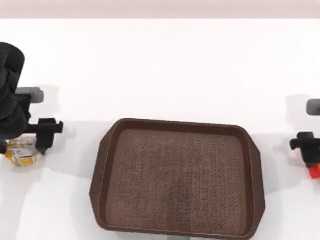<figcaption>frame 25, 1.00s</figcaption></figure><figure>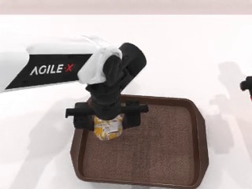<figcaption>frame 50, 2.00s</figcaption></figure><figure><figcaption>frame 60, 2.40s</figcaption></figure>

Completion check triggered → updated instruction ready: <b>365.2 ms</b>; completion check triggered → first low-level action: <b>371.1 ms</b>; low-level neural inference for this action: <b>0.0 ms</b>

View exact model input and output

The following is the exact English input sent to the models and their raw output, retained for reproducibility.
<h4>Completion verifier: full input</h4><pre>Verify whether the current robot subtask is completed.
Task: Pick up the rounded rectangular hamburg wrap and the Golden fries in red carton box together, then drop on the medium flat tray
Current subtask: Pick up the rounded rectangular hamburg wrap and the Golden fries in red carton box and place them on the medium flat tray
Images: 4 accumulated head-camera frames not previously sent to high-level: [0, 25, 50, 60]
Use completed=true only when the subtask's final goal state is clearly visible. Otherwise use completed=false.
Return exactly one JSON object and no Markdown:
{"completed": true | false}</pre><h4>Completion verifier: raw output</h4><pre>evidence_frame_ids=[0, 25, 50, 60]
{"completed": false}</pre><h4>Next-subtask planner: full input</h4><pre>Generate the next object-level robot subtask.
Task: Pick up the rounded rectangular hamburg wrap and the Golden fries in red carton box together, then drop on the medium flat tray
Current subtask: Pick up the rounded rectangular hamburg wrap and the Golden fries in red carton box and place them on the medium flat tray
Next subtask index: 2
The new subtask must name the object and its final target.
Do not repeat the current subtask. Do not verify completion.
Do not output a grasp-only, lift-only, move-only, or release-only step.
Return exactly one JSON object and no Markdown:
{"next_subtask": string}</pre><h4>Next-subtask planner: raw output</h4><pre>evidence_frame_ids=[]; text_only=true
{"next_subtask": "Pick up the rounded rectangular hamburg wrap and place it on the medium flat tray"}</pre>
</article><article><h3>Put bottles in dustbin / History sampled at 1 frame per second / Sample 0</h3>
Raw VLM output: <code>evidence_frame_ids=[0, 25, 50, 75, 100, 101]
{"completed": false}</code>; system action: <code>continue the current subtask</code>; evidence frames: [0, 25, 50, 75, 100, 101]

 <strong><a href="docs/high-level-visual-memory-report/assets/rollouts/1hz_next_put_bottles_dustbin_ep0.mp4">Open or download the original MP4</a></strong>

<figure><figcaption>frame 0, 0.00s</figcaption></figure><figure>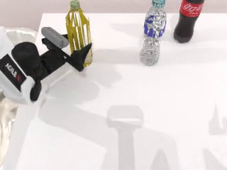<figcaption>frame 25, 1.00s</figcaption></figure><figure>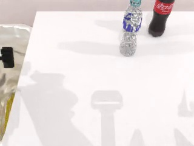<figcaption>frame 50, 2.00s</figcaption></figure><figure>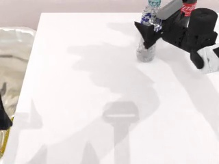<figcaption>frame 75, 3.00s</figcaption></figure><figure>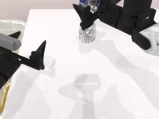<figcaption>frame 100, 4.00s</figcaption></figure><figure>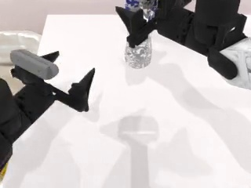<figcaption>frame 101, 4.04s</figcaption></figure>

Completion check triggered → updated instruction ready: <b>480.9 ms</b>; completion check triggered → first low-level action: <b>487.5 ms</b>; low-level neural inference for this action: <b>0.0 ms</b>

View exact model input and output

The following is the exact English input sent to the models and their raw output, retained for reproducibility.
<h4>Completion verifier: full input</h4><pre>Verify whether the current robot subtask is completed.
Task: Move the plastic bottle with two distinct parts, the bottle with blue highlights, and the plastic bottle with ridges near bottom into the curved rectangular trash can on the left of the table.
Current subtask: Move the plastic bottle with two distinct parts into the curved rectangular trash can on the left of the table.
Images: 6 accumulated head-camera frames not previously sent to high-level: [0, 25, 50, 75, 100, 101]
Use completed=true only when the subtask's final goal state is clearly visible. Otherwise use completed=false.
Return exactly one JSON object and no Markdown:
{"completed": true | false}</pre><h4>Completion verifier: raw output</h4><pre>evidence_frame_ids=[0, 25, 50, 75, 100, 101]
{"completed": false}</pre><h4>Next-subtask planner: full input</h4><pre>Generate the next object-level robot subtask.
Task: Move the plastic bottle with two distinct parts, the bottle with blue highlights, and the plastic bottle with ridges near bottom into the curved rectangular trash can on the left of the table.
Current subtask: Move the plastic bottle with two distinct parts into the curved rectangular trash can on the left of the table.
Next subtask index: 2
The new subtask must name the object and its final target.
Do not repeat the current subtask. Do not verify completion.
Do not output a grasp-only, lift-only, move-only, or release-only step.
Return exactly one JSON object and no Markdown:
{"next_subtask": string}</pre><h4>Next-subtask planner: raw output</h4><pre>evidence_frame_ids=[]; text_only=true
{"next_subtask": "Move the bottle with blue highlights into the curved rectangular trash can on the left of the table."}</pre>
</article><article><h3>Place burger and fries / History sampled every 2 seconds / Sample 0</h3>
Raw VLM output: <code>evidence_frame_ids=[0, 50, 60]
{"completed": false}</code>; system action: <code>continue the current subtask</code>; evidence frames: [0, 50, 60]

 <strong><a href="docs/high-level-visual-memory-report/assets/rollouts/2s_next_place_burger_fries_ep0.mp4">Open or download the original MP4</a></strong>

<figure>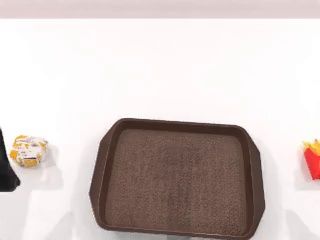<figcaption>frame 0, 0.00s</figcaption></figure><figure>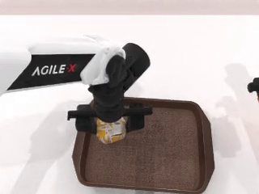<figcaption>frame 50, 2.00s</figcaption></figure><figure><figcaption>frame 60, 2.40s</figcaption></figure>

Completion check triggered → updated instruction ready: <b>326.0 ms</b>; completion check triggered → first low-level action: <b>331.9 ms</b>; low-level neural inference for this action: <b>0.0 ms</b>

View exact model input and output

The following is the exact English input sent to the models and their raw output, retained for reproducibility.
<h4>Completion verifier: full input</h4><pre>Verify whether the current robot subtask is completed.
Task: Pick up the rounded rectangular hamburg wrap and the Crispy potato fries with red box and place them on the flat brown serving tray.
Current subtask: Pick up the rounded rectangular hamburg wrap and place it on the flat brown serving tray
Images: 3 accumulated head-camera frames not previously sent to high-level: [0, 50, 60]
Use completed=true only when the subtask's final goal state is clearly visible. Otherwise use completed=false.
Return exactly one JSON object and no Markdown:
{"completed": true | false}</pre><h4>Completion verifier: raw output</h4><pre>evidence_frame_ids=[0, 50, 60]
{"completed": false}</pre><h4>Next-subtask planner: full input</h4><pre>Generate the next object-level robot subtask.
Task: Pick up the rounded rectangular hamburg wrap and the Crispy potato fries with red box and place them on the flat brown serving tray.
Current subtask: Pick up the rounded rectangular hamburg wrap and place it on the flat brown serving tray
Next subtask index: 2
The new subtask must name the object and its final target.
Do not repeat the current subtask. Do not verify completion.
Do not output a grasp-only, lift-only, move-only, or release-only step.
Return exactly one JSON object and no Markdown:
{"next_subtask": string}</pre><h4>Next-subtask planner: raw output</h4><pre>evidence_frame_ids=[]; text_only=true
{"next_subtask": "Pick up the Crispy potato fries with red box and place them on the flat brown serving tray"}</pre>
</article><article><h3>Put bottles in dustbin / History sampled every 2 seconds / Sample 0</h3>
Raw VLM output: <code>evidence_frame_ids=[0, 50, 100, 101]
{"completed": false}</code>; system action: <code>continue the current subtask</code>; evidence frames: [0, 50, 100, 101]

<a href="docs/high-level-visual-memory-report/assets/rollouts/2s_next_put_bottles_dustbin_ep0.mp4">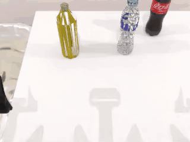</a> <strong><a href="docs/high-level-visual-memory-report/assets/rollouts/2s_next_put_bottles_dustbin_ep0.mp4">Open or download the original MP4</a></strong>

<figure>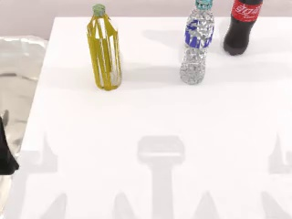<figcaption>frame 0, 0.00s</figcaption></figure><figure>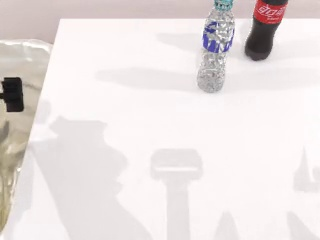<figcaption>frame 50, 2.00s</figcaption></figure><figure>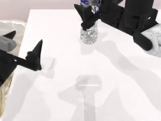<figcaption>frame 100, 4.00s</figcaption></figure><figure>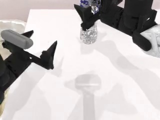<figcaption>frame 101, 4.04s</figcaption></figure>

Completion check triggered → updated instruction ready: <b>382.0 ms</b>; completion check triggered → first low-level action: <b>387.9 ms</b>; low-level neural inference for this action: <b>0.0 ms</b>

View exact model input and output

The following is the exact English input sent to the models and their raw output, retained for reproducibility.
<h4>Completion verifier: full input</h4><pre>Verify whether the current robot subtask is completed.
Task: Pick up the plastic bottle with two distinct parts and drop it into the simple black garbage bin, do the same for the bottle with blue highlights and the bottle with red screw cap.
Current subtask: Pick up the plastic bottle with two distinct parts and drop it into the simple black garbage bin
Images: 4 accumulated head-camera frames not previously sent to high-level: [0, 50, 100, 101]
Use completed=true only when the subtask's final goal state is clearly visible. Otherwise use completed=false.
Return exactly one JSON object and no Markdown:
{"completed": true | false}</pre><h4>Completion verifier: raw output</h4><pre>evidence_frame_ids=[0, 50, 100, 101]
{"completed": false}</pre><h4>Next-subtask planner: full input</h4><pre>Generate the next object-level robot subtask.
Task: Pick up the plastic bottle with two distinct parts and drop it into the simple black garbage bin, do the same for the bottle with blue highlights and the bottle with red screw cap.
Current subtask: Pick up the plastic bottle with two distinct parts and drop it into the simple black garbage bin
Next subtask index: 2
The new subtask must name the object and its final target.
Do not repeat the current subtask. Do not verify completion.
Do not output a grasp-only, lift-only, move-only, or release-only step.
Return exactly one JSON object and no Markdown:
{"next_subtask": string}</pre><h4>Next-subtask planner: raw output</h4><pre>evidence_frame_ids=[]; text_only=true
{"next_subtask": "Pick up the bottle with blue highlights and drop it into the simple black garbage bin"}</pre>
</article><article><h3>Place burger and fries / Current image only / Sample 0</h3>
Raw VLM output: <code>evidence_frame_ids=[60]
{"completed": false}</code>; system action: <code>continue the current subtask</code>; evidence frames: [60]

<a href="docs/high-level-visual-memory-report/assets/rollouts/single_next_place_burger_fries_ep0.mp4">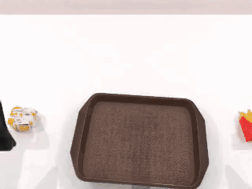</a> <strong><a href="docs/high-level-visual-memory-report/assets/rollouts/single_next_place_burger_fries_ep0.mp4">Open or download the original MP4</a></strong>

<figure>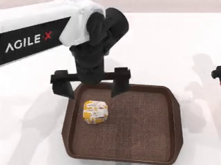<figcaption>frame 60, 2.40s</figcaption></figure>

Completion check triggered → updated instruction ready: <b>214.2 ms</b>; completion check triggered → first low-level action: <b>220.5 ms</b>; low-level neural inference for this action: <b>0.0 ms</b>

View exact model input and output

The following is the exact English input sent to the models and their raw output, retained for reproducibility.
<h4>Completion verifier: full input</h4><pre>Verify whether the current robot subtask is completed.
Task: Pick up the hamburg with uneven white surface and the Crispy potato fries with red box and place them on the flat brown serving tray.
Current subtask: Pick up the hamburg with uneven white surface and place it on the flat brown serving tray
Images: one current head-camera frame
Use completed=true only when the subtask's final goal state is clearly visible. Otherwise use completed=false.
Return exactly one JSON object and no Markdown:
{"completed": true | false}</pre><h4>Completion verifier: raw output</h4><pre>evidence_frame_ids=[60]
{"completed": false}</pre><h4>Next-subtask planner: full input</h4><pre>Generate the next object-level robot subtask.
Task: Pick up the hamburg with uneven white surface and the Crispy potato fries with red box and place them on the flat brown serving tray.
Current subtask: Pick up the hamburg with uneven white surface and place it on the flat brown serving tray
Next subtask index: 2
The new subtask must name the object and its final target.
Do not repeat the current subtask. Do not verify completion.
Do not output a grasp-only, lift-only, move-only, or release-only step.
Return exactly one JSON object and no Markdown:
{"next_subtask": string}</pre><h4>Next-subtask planner: raw output</h4><pre>evidence_frame_ids=[]; text_only=true
{"next_subtask": "Pick up the Crispy potato fries with red box and place them on the flat brown serving tray"}</pre>
</article><article><h3>Put bottles in dustbin / Current image only / Sample 0</h3>
Raw VLM output: <code>evidence_frame_ids=[101]
{"completed": false}</code>; system action: <code>continue the current subtask</code>; evidence frames: [101]

<a href="docs/high-level-visual-memory-report/assets/rollouts/single_next_put_bottles_dustbin_ep0.mp4">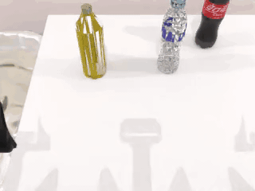</a> <strong><a href="docs/high-level-visual-memory-report/assets/rollouts/single_next_put_bottles_dustbin_ep0.mp4">Open or download the original MP4</a></strong>

<figure>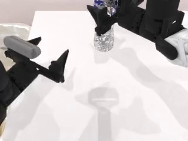<figcaption>frame 101, 4.04s</figcaption></figure>

Completion check triggered → updated instruction ready: <b>212.7 ms</b>; completion check triggered → first low-level action: <b>217.8 ms</b>; low-level neural inference for this action: <b>0.0 ms</b>

View exact model input and output

The following is the exact English input sent to the models and their raw output, retained for reproducibility.
<h4>Completion verifier: full input</h4><pre>Verify whether the current robot subtask is completed.
Task: Pick up the yellow plastic bottle, drop it into the simple black garbage bin, then repeat for the bottle with blue highlights and the medium black bottle.
Current subtask: Pick up the yellow plastic bottle and drop it into the simple black garbage bin
Images: one current head-camera frame
Use completed=true only when the subtask's final goal state is clearly visible. Otherwise use completed=false.
Return exactly one JSON object and no Markdown:
{"completed": true | false}</pre><h4>Completion verifier: raw output</h4><pre>evidence_frame_ids=[101]
{"completed": false}</pre><h4>Next-subtask planner: full input</h4><pre>Generate the next object-level robot subtask.
Task: Pick up the yellow plastic bottle, drop it into the simple black garbage bin, then repeat for the bottle with blue highlights and the medium black bottle.
Current subtask: Pick up the yellow plastic bottle and drop it into the simple black garbage bin
Next subtask index: 2
The new subtask must name the object and its final target.
Do not repeat the current subtask. Do not verify completion.
Do not output a grasp-only, lift-only, move-only, or release-only step.
Return exactly one JSON object and no Markdown:
{"next_subtask": string}</pre><h4>Next-subtask planner: raw output</h4><pre>evidence_frame_ids=[]; text_only=true
{"next_subtask": "Pick up the bottle with blue highlights and drop it into the simple black garbage bin"}</pre>
</article>
<section><h2>Historical n=10: VLM Completion-Detection Accuracy</h2>
This table retains the results of the earlier n=10 experiment. At every measurement boundary, simulator ground truth marked the current subtask as completed; a VLM response is correct only when it also reports completion.

This measures recall for recognizing completion at the selected boundary, not classification accuracy on a balanced completed/unfinished dataset.
<table><thead><tr><th>Subtask planning method</th><th>Visual input</th><th>Robot task</th><th>Samples</th><th>Simulator ground truth: completed</th><th>Model predicted: completed</th><th>Correct</th><th>Completion recall</th><th>False negatives</th></tr></thead><tbody><tr><td>Incremental subtask planning</td><td>Current image only</td><td>Place burger and fries</td><td>10</td><td>10</td><td>1</td><td>1/10</td><td>10.0%</td><td>9</td></tr><tr><td>Full plan generated at task start</td><td>Current image only</td><td>Place burger and fries</td><td>10</td><td>10</td><td>0</td><td>0/10</td><td>0.0%</td><td>10</td></tr><tr><td>Incremental subtask planning</td><td>History sampled every 2 seconds</td><td>Place burger and fries</td><td>10</td><td>10</td><td>0</td><td>0/10</td><td>0.0%</td><td>10</td></tr><tr><td>Full plan generated at task start</td><td>History sampled every 2 seconds</td><td>Place burger and fries</td><td>10</td><td>10</td><td>0</td><td>0/10</td><td>0.0%</td><td>10</td></tr><tr><td>Incremental subtask planning</td><td>History sampled at 1 frame per second</td><td>Place burger and fries</td><td>10</td><td>10</td><td>2</td><td>2/10</td><td>20.0%</td><td>8</td></tr><tr><td>Full plan generated at task start</td><td>History sampled at 1 frame per second</td><td>Place burger and fries</td><td>10</td><td>10</td><td>1</td><td>1/10</td><td>10.0%</td><td>9</td></tr><tr><td>Incremental subtask planning</td><td>Current image only</td><td>Put bottles in dustbin</td><td>10</td><td>10</td><td>0</td><td>0/10</td><td>0.0%</td><td>10</td></tr><tr><td>Full plan generated at task start</td><td>Current image only</td><td>Put bottles in dustbin</td><td>10</td><td>10</td><td>0</td><td>0/10</td><td>0.0%</td><td>10</td></tr><tr><td>Incremental subtask planning</td><td>History sampled every 2 seconds</td><td>Put bottles in dustbin</td><td>10</td><td>10</td><td>0</td><td>0/10</td><td>0.0%</td><td>10</td></tr><tr><td>Full plan generated at task start</td><td>History sampled every 2 seconds</td><td>Put bottles in dustbin</td><td>10</td><td>10</td><td>0</td><td>0/10</td><td>0.0%</td><td>10</td></tr><tr><td>Incremental subtask planning</td><td>History sampled at 1 frame per second</td><td>Put bottles in dustbin</td><td>10</td><td>10</td><td>0</td><td>0/10</td><td>0.0%</td><td>10</td></tr><tr><td>Full plan generated at task start</td><td>History sampled at 1 frame per second</td><td>Put bottles in dustbin</td><td>10</td><td>10</td><td>1</td><td>1/10</td><td>10.0%</td><td>9</td></tr><tr><th colspan="3">Total</th><th>120</th><th>120</th><th>5</th><th>5/120</th><th>4.2%</th><th>115</th></tr></tbody></table></section>
</main>
